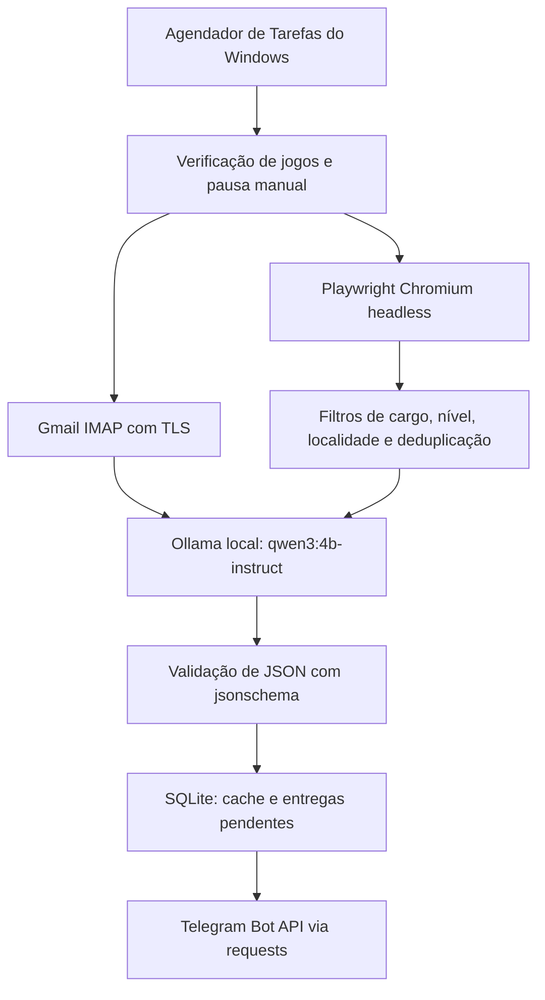

# Automações com IA local para Windows

Assistente em segundo plano que transforma e-mails em alertas de urgência e reúne vagas em um boletim no Telegram. Desenvolvido em Python para Windows 11, com inferência local via Ollama e navegação headless com Playwright.

O projeto nasceu de uma necessidade prática: acompanhar oportunidades e mensagens importantes sem contratar APIs de IA ou interromper o uso do computador.

## Funcionalidades

| Rotina | Entrada | Resultado |
|---|---|---|
| Classificador de e-mails | Não lidos recebidos no Gmail nas últimas 24 horas | Urgência Alta/Média/Baixa e resumo; somente Alta gera alerta |
| Buscador de vagas | Nerdin, Gupy, RioVagas e Indeed | Até 10 vagas únicas de TI júnior, com empresa, localidade, modalidade e link original |
| Proteção durante jogos | Processos de jogos e launchers conhecidos | Impede o início ou interrompe as rotinas ao detectar jogos/launchers |

As vagas precisam ser **100% home office em qualquer localidade**, ou presenciais/híbridas **na cidade do Rio de Janeiro ou na Baixada Fluminense**. A lista de cidades está em [`job_preferences.py`](job_preferences.py).

## Arquitetura



## Decisões de engenharia

- **IA local:** conteúdo de e-mails é processado no computador. Não há API comercial de IA ou fallback pago. Resumos de urgência Alta são transmitidos ao Telegram.
- **Regras antes da IA:** cargo, senioridade, região e links são verificados pelo código. A IA classifica, resume e ordena candidatos; não cria URLs nem preenche localizações ausentes.
- **Falhas isoladas por fonte:** uma fonte indisponível não impede a consulta das demais. Falha de todos os sites é diferenciada de uma busca bem-sucedida sem resultados.
- **Estado persistente:** SQLite evita reclassificações e registra entregas confirmadas. Alertas pendentes podem ser retomados após falhas.
- **Execução discreta:** tarefas usam `pythonw.exe`; navegador e servidor local iniciam sem janela. Não há controle de teclado ou mouse.
- **Controle de recursos:** chamadas de IA serializadas, duas threads de CPU, GPU desativada e descarregamento do modelo após cada resposta.
- **Pausa durante jogos:** Steam, Riot Client, Valorant, League of Legends, Roblox e outros launchers conhecidos bloqueiam as rotinas. A verificação durante a execução ocorre a cada dois segundos, sem acessar memória dos jogos.

## Tecnologias

Python · Playwright · requests · Ollama · IMAP/TLS · SQLite · jsonschema · psutil · filelock · PowerShell · Agendador de Tarefas

## Executar no Windows

Requisitos: Windows 11, Python 3.11 ou posterior, espaço para Chromium/Ollama/modelo, Gmail com senha de app e um bot do Telegram. O modelo precisa de RAM disponível; o consumo varia conforme o texto e o ambiente.

```powershell
py -3 -m venv .venv
.\.venv\Scripts\python.exe -m pip install -r requirements.txt
$env:PLAYWRIGHT_BROWSERS_PATH = Join-Path $PWD '.venv\browsers'
.\.venv\Scripts\python.exe -m playwright install chromium --only-shell
```

Siga o **[guia de instalação e configuração](docs/INSTALACAO.md)** para instalar o Ollama portátil, baixar o modelo e cadastrar credenciais. Instalar as dependências Python, sozinho, não instala a IA local.

Depois da configuração:

```powershell
.\.venv\Scripts\python.exe email_classifier.py
.\.venv\Scripts\python.exe job_finder.py
```

Para registrar as rotinas sem janela:

```powershell
powershell.exe -NoProfile -ExecutionPolicy Bypass -File .\install_tasks.ps1
```

O padrão é verificar e-mails a cada 15 minutos e buscar vagas diariamente às 09:00, no horário local do Windows. O usuário precisa estar conectado e o computador ligado, acordado e com internet. Clonar o repositório não cria as tarefas.

## Testes

```powershell
.\.venv\Scripts\python.exe -m unittest test_automations -v
```

A suíte usa mocks, banco em memória, estado temporário e uma página local simulada para extração Playwright. Não precisa de credenciais, não chama a IA e não envia mensagens reais. Cobre filtros de TI júnior e localização, extração, deduplicação, URLs, classificação/entrega de alertas e pausa durante jogos.

## Organização

| Arquivo | Responsabilidade |
|---|---|
| `email_classifier.py` | Coleta IMAP, classificação e alertas de urgência Alta |
| `job_finder.py` | Coletores, agregação, ranking e boletim de vagas |
| `job_preferences.py` | Regras de localidade e modalidade |
| `common.py` | IA local, HTTP, logs, cache e controle de entregas |
| `gaming_guard.py` | Detecção de jogos e interrupção das rotinas |
| `runtime_paths.py` | Diretório de dados e resolução da configuração |
| `configure_gmail.py` / `configure_telegram.py` | Configuração assistida das contas |
| `install_tasks.ps1` | Registro dos agendamentos Windows |
| `test_automations.py` | Testes automatizados |

## Privacidade e limitações

Credenciais ficam fora do repositório, no diretório de dados da conta Windows. `.env.example` contém apenas exemplos. `.gitignore` exclui segredos, bancos, logs, modelos e arquivos específicos da instalação. O arquivo de credenciais é texto simples, não um cofre criptografado.

Não há custo por chamada de IA nesta implementação. Energia, internet e armazenamento são recursos do computador; serviços externos podem mudar suas condições. O projeto não migra automaticamente para serviços pagos.

Sites podem bloquear automação ou mudar de layout. CAPTCHA e login obrigatório não são contornados; a coleta do Indeed pode ficar indisponível. A IA pode classificar incorretamente, textos longos são truncados e a detecção de jogos não cobre todo executável portátil ou futuro. O Telegram pode receber uma mensagem duplicada se aceitá-la e a conexão cair antes da confirmação.

Este repositório não inclui e-mails reais, credenciais ou histórico de alertas. Exemplos de saída devem ser fictícios.
